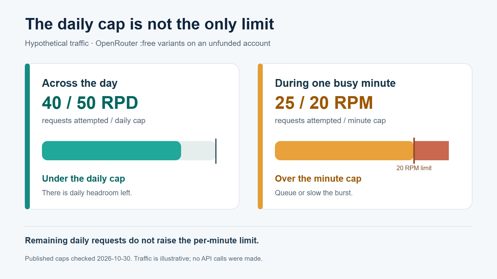

# Free LLM APIs: Recurring Free Tiers, Limits, and When to Pay

*Free access can help start a prototype; the applicable model and usage limits still decide how far it goes. Conceptual illustration.*

A free LLM API can be a workable way to test a text feature without paying for each request. Check whether the offer covers the **model and account you will actually use**, and whether it continues after signup credits expire. The official pages checked on October 30, 2026 describe current free-plan paths for selected Gemini API models, Groq Free, OpenRouter's `:free` variants and eligible Cloudflare Workers AI models. None promises unchanged access forever.

Start with the route that fits your stack and sample traffic, then check its account-level limits. A request cap, token cap, project restriction or model eligibility rule can stop a prototype well before a headline “free” label seems exhausted. Plan a paid fallback before users depend on the feature.

This article is published by Moduck, an AI API aggregator. We found no verified Moduck free LLM API offer or evidence that every listed model can be called through Moduck, so Moduck is not included as a free-tier option below.

## Four currently published free API routes

These are examples of **recurring published allocations**, not one-time promotional credits. Each row uses the vendor's own units and applies only to eligible models and accounts. The terms can change.

| Route | Published no-charge path | First limit to inspect |
| --- | --- | --- |
| [Gemini API pricing](https://ai.google.dev/gemini-api/docs/pricing) | Free input and output tokens for certain models, including `gemini-2.5-flash` on the standard tier | Model and project eligibility; live RPM, input TPM and RPD in AI Studio |
| [Groq rate limits](https://console.groq.com/docs/rate-limits) | Groq Free plan with model-specific request and token limits | Your organization's exact RPM, RPD, TPM and TPD; a public `openai/gpt-oss-120b` row shows 30 RPM and 1,000 RPD as a summary, not your guaranteed allowance |
| [OpenRouter free models](https://openrouter.ai/collections/free-models) | Unfunded accounts can call `:free` variants at $0 model pricing | 20 RPM and 50 RPD for those variants; failed attempts count toward the daily cap |
| [Workers AI pricing](https://developers.cloudflare.com/workers-ai/platform/pricing/) | 10,000 Neurons per day at no charge on Workers Free or Paid | Neuron use by the chosen model; some models, including `@cf/deepseek-ai/deepseek-v4.1-flash-1017`, require a paid billing method even within the allocation |

These limits use different units, so a larger number does not necessarily mean more usable capacity. OpenRouter's 50 requests say nothing about prompt length; Cloudflare's Neurons measure compute rather than a simple request count. Gemini's free token price does not publish a universal requests-per-day promise on the pricing page. Groq's public table is a high-level summary and directs users to their organization's limits page for exact values.

## The limit that actually stops your app

Suppose a prototype sends 40 requests a day, mostly in a quiet hour, but occasionally sends 25 in one minute. That shape would fit a 50-request daily cap yet exceed OpenRouter's published 20 RPM cap for `:free` variants during the burst. That burst needs queuing or a slower request rate even while the daily total remains below 50. Retries can consume the daily budget too: OpenRouter says failed attempts count. The example is hypothetical; we made no requests and measured no real workload.

*Published OpenRouter :free limits checked October 30, 2026; the traffic pattern is hypothetical. No API requests were made.*

With Gemini, check three meters—requests per minute (RPM), input tokens per minute (TPM) and requests per day (RPD)—for the selected model in AI Studio. Google applies rate limits per **project**, not per API key. It also warns that some projects or accounts are [ineligible for the free tier](https://ai.google.dev/gemini-api/docs/troubleshooting). Creating another key in a restricted project will not make that project eligible.

Groq applies its request and token limits at the **organization** level, and any one dimension can bind first. Cloudflare instead deducts model-dependent Neurons from a daily allocation, so estimate the intended prompt and output mix using the chosen model's published unit price. Its daily limit resets at 00:00 UTC. These different meters are why “X free tokens” is a poor cross-provider shortcut.

Eligibility is only part of fit. Google's Gemini pricing table says free-tier content is used to improve its products; its paid-tier column says otherwise. If your prototype handles sensitive customer material, review the applicable data terms before sending it. The fact that an API has a $0 line does not by itself make it suitable for that data.

## Choose a free route—and know when to pay

For a simple Gemini feature, start by checking whether the **specific** Gemini model has a free standard-tier price and whether your project is eligible. If either condition fails, its free price is irrelevant to your app. For an open-weight model on Groq, check your organization's live limits and the chosen model ID; the public table is a starting point, not an account entitlement.

OpenRouter's `:free` variants are useful when exploring several models behind one API and 50 daily attempts are enough. If failed calls, bursts or a fixed model requirement consume that allowance, compare a paid route instead. Workers AI makes the most sense to investigate when the app already fits the Workers environment and the chosen model is eligible for the free allocation; a 10,000-Neuron budget should be translated into your own request mix before relying on it.

Paying becomes a practical choice when the required model is outside the free set, the binding cap is below the app's peak workload, the data terms are unsuitable, or predictable capacity matters more than a zero inference bill. A paid plan is not automatically better: compare its actual rates, limits and data terms against the workload, and retain a graceful response to rate-limit errors. We have not benchmarked speed, output quality or availability across these routes.

## Check the exact account before you build around free capacity

Before committing the integration, verify four things in the intended account and region:

1. The exact model and API endpoint are accessible on that account's free tier.
2. Its current per-minute and daily limits cover both the average load and the busiest minute; for Workers AI, estimate Neurons for the actual input/output mix.
3. Data-use, retention and commercial terms fit the content you plan to send.
4. The paid fallback's price and capacity fit the project if the free route stops meeting demand.

A model name in a catalog, a public pricing row or a second API key cannot establish those conditions. Recheck the live terms before launch because the vendor pages and account settings can change.

Moduck's confirmed role is an AI API aggregator for developers and product teams, with a goal of making model discovery, pricing information and API access clearer. This article has not verified a Moduck free tier, specific model eligibility or a successful request. If an aggregator is on your shortlist, check its current model and endpoint documentation before choosing an integration route. [Read the documentation](https://docs.moduck.ai/). Confirm eligibility, prices and limits for your account; no Moduck free tier is established here.
